# Sistema de Gestión de Tareas con API y Base de Datos

## Descripción

API REST desarrollada con Python y Flask para gestionar usuarios y tareas, utilizando SQLite para la persistencia de datos y Argon2 para proteger las contraseñas mediante hashing.

## Tecnologías

- Python
- Flask
- SQLite
- Argon2

## Instalación y ejecución

1. Instalar las dependencias:

   ```bash
   pip install Flask argon2-cffi
   ```

2. Ejecutar el servidor:

   ```bash
   python servidor.py
   ```

3. Abrir http://127.0.0.1:5000/tareas para consultar la página de bienvenida y la documentación de los endpoints.

## Funcionalidades

- Registro de usuarios e inicio de sesión.
- Hashing de contraseñas con Argon2.
- Autenticación mediante tokens de sesión.
- Operaciones CRUD sobre tareas.
- Persistencia de datos con SQLite.
- Página HTML con la documentación de la API.

## Capturas de pantalla

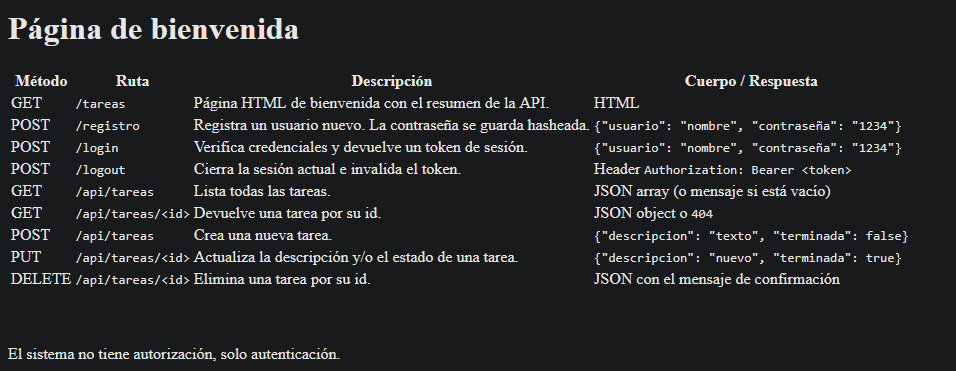
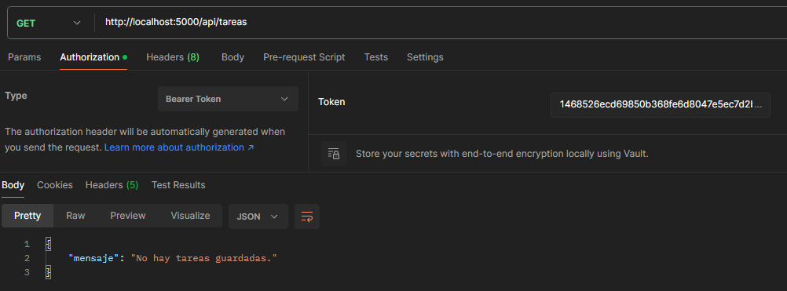
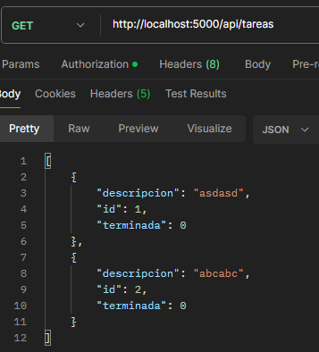
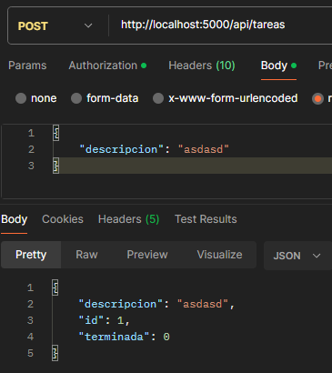
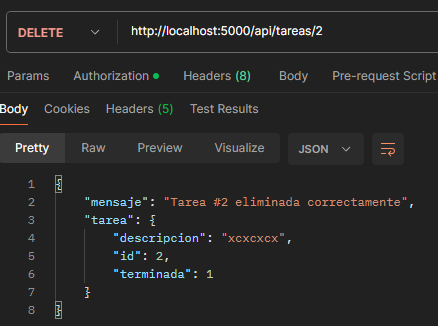
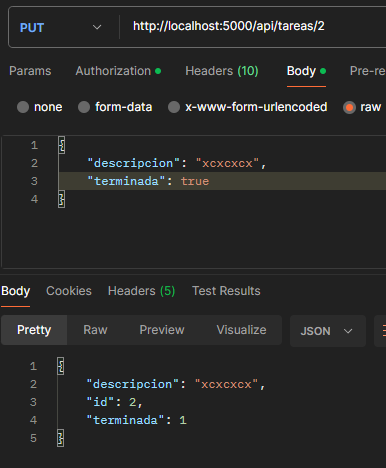
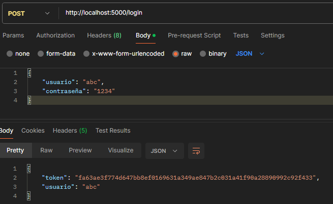
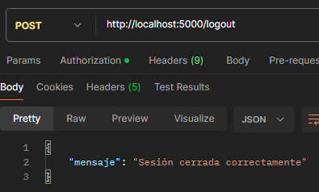
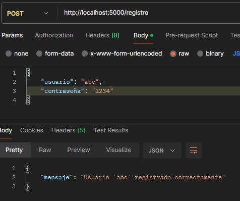
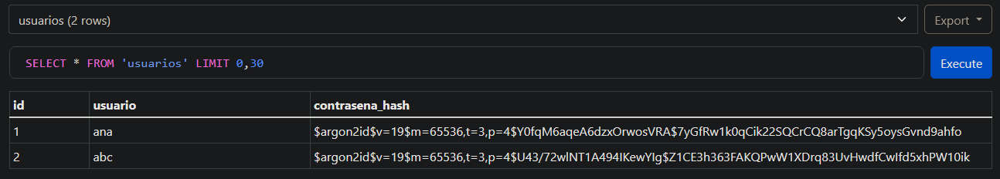
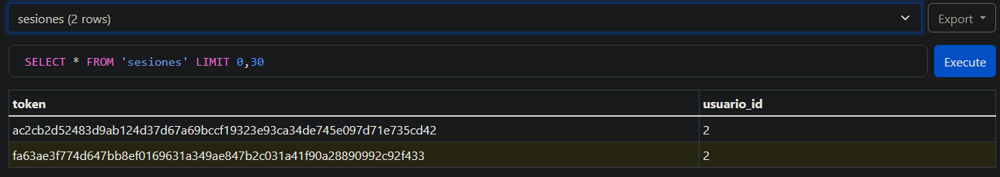

Más capturas de las pruebas se encuentran en la carpeta `screenshoots`.

## ¿Por qué hashear contraseñas?

Para aumentar la dificultad de comprometer a muchos usuarios al mismo tiempo en caso de que se filtre la base de datos. Si las contraseñas están hasheadas y salteadas entonces un atacante debe usar rainbow tables, lo que toma un tiempo infeasible.

## Ventajas de usar SQLite en este proyecto

- Facil de usar.
- Rápido y ligero.
- Ideal para aplicaciones pequeñas.
- Integración con python excelente.
